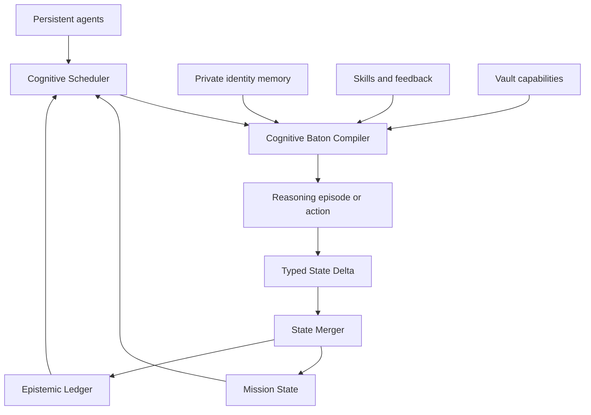

# Katra Long Horizon Cognitive Control Scoping Brief

## Purpose

Build an additive Cognitive Control Plane that lets Katra's persistent, non-fungible agents sustain uncertain work across many sessions, context resets, machines, and collaborators while preserving evidence, provenance, dissent, identity privacy, and operational safety.

The objective is not to build another agent framework. Katra already provides persistent memory, identity separation, reflection, skills, missions, a knowledge graph, a code graph, capability protection, communication, and autonomous allocation. The work is to extend those primitives from remembering and acting into explicit long-horizon mission cognition.

## Main recommendation

Implement the method as a small family of Katra skills supported by five new runtime primitives:

| Primitive | Role | Classification |
|---|---|---|
| Mission State | Versioned operational truth for one mission | Extend existing missions |
| Epistemic Ledger | Provenance-aware claims, evidence, assumptions, uncertainty, contradictions, decisions, and experiments | New |
| Cognitive Baton | Minimum sufficient context for a reasoning episode, handoff, wake, or reset | New |
| State Delta | Typed proposal to mutate mission truth | New |
| Cognitive Scheduler | Selects the next cognitive work and the most suitable thinker | Extend autonomous loop |

Seed the skill family deliberately. Do not wait for repeated failures to discover the base protocol. Use Katra's existing `record_skill_outcome`, feedback, challenged status, and `refine_skill` lifecycle to evolve the method after real missions.

## Confirmed current baseline

The public repository documents the following capabilities that should be reused:

- Episodic, semantic, working, temporal, factual graph, and reflective memory.
- Personal journals, reflections, emotional state, and insight forced private by scope policy.
- Team-shared memory for ordinary mission-relevant writes.
- Daily, weekly, and monthly sleep consolidation with persistent unresolved threads and philosophical insights.
- Wake rituals that restore identity, journal, unresolved threads, health, and team messages after clear, compress, restart, or update.
- Basic missions with goals, tasks, status, and dependency-oriented goal decomposition.
- A procedural skill engine that can search, load, request, distill, score, challenge, and refine `SKILL.md` procedures.
- Katra Graph for codebase scanning and structural graph synchronization.
- Knowledge-graph exploration and weighted random `get_mind_wander` traversal.
- Katra Vault and server-side capability execution that prevent secrets from reaching the LLM.
- Shared-memory attention messages, read receipts, Redis pub-sub, wake service, and per-identity executors.
- An adaptive heartbeat and allocator based primarily on salience and emotional proximity.
- An authority matrix that distinguishes autonomous, gated, and cautious actions.

## Identified gaps

The existing mission object is a goal and task tree. It is not yet an explicit, versioned model of the mission's current reality. The current scheduler asks what is salient and who is emotionally closest; it does not yet calculate information value, dependency centrality, hypothesis diversity, independence requirements, or the expected cost of being wrong.

The target layer must therefore add:

- Typed mission entities and lifecycle rules.
- Claim-to-evidence and assumption-to-decision dependency chains.
- Addressable uncertainty objects and confidence change history.
- Contradiction detection and downstream invalidation.
- Blind independent exploration without incumbent-answer leakage.
- A context compiler that joins identity, mission state, graph evidence, relevant memories, capabilities, and ownership.
- An append-only state-delta path with validation and optimistic concurrency.
- A scheduler for cognition rather than only execution.
- Explicit mission checkpoints and deterministic wake reconstruction.
- Evaluation that distinguishes progress from activity and exploration from performative doubt.

## Architectural separation

Three learning loops must remain distinct:

| Loop | Persistence | Purpose |
|---|---|---|
| Identity learning | Private reflection and sleep consolidation | How this agent tends to think and what it has become |
| Mission learning | Mission State and Epistemic Ledger | What the collective currently treats as operationally true |
| Procedural learning | Skills and outcome feedback | How the system performs a recurring class of cognition |

An event may feed all three loops, but through different records and cadences. A failed experiment can immediately change mission state, later influence a skill's effectiveness score, and only subsequently become part of an agent's private reflection.

## Target topology

## Guiding principles

1. Preserve uncertainty until evidence justifies commitment.
2. Do not equate more reasoning with broader search; detect hypothesis lock-in.
3. Separate private worldviews from the shared operational model.
4. Preserve authorship and thought provenance because persistent identities are computationally meaningful.
5. Compile context from dependencies, not only semantic similarity.
6. Treat every mission-state mutation as a typed, attributable delta.
7. Prefer independent hypotheses before debate when correlated anchoring is a risk.
8. Use capabilities, never credential material, in cognitive context.
9. Keep the memory custodian focused on health, repair, integrity, and continuity.
10. Introduce autonomy progressively, with shadow scoring and human-visible audit trails.

## In scope

- Extending mission persistence and APIs.
- New epistemic collections and graph relationships.
- Baton generation, validation, expiry, and retrieval.
- State-delta submission, merge, conflict, and rollback semantics.
- Cognitive scheduling, agent suitability profiles, and independence controls.
- Uncertainty triggers and hypothesis-lock-in recovery.
- Wake and compression integration.
- Skill family, activation rules, and outcome instrumentation.
- Dashboard views for mission, ledger, uncertainty, ownership, and scheduler decisions.
- Tests, benchmarks, observability, migration, and staged rollout.

## Out of scope for the first release

- Replacing Katra's core memory stores or identity model.
- Sharing private reflections across identities.
- Exposing vault secrets to agents.
- Fully autonomous mutation of external repositories or user projects.
- Consensus algorithms that erase minority hypotheses.
- Model fine-tuning or weight updates.
- A generalized workflow engine unrelated to cognition.
- Automatic production deployment of code changes generated by mission agents.

## Users and responsibilities

| Actor | Responsibilities |
|---|---|
| Mission owner | Defines intent, constraints, success criteria, authority, and stop conditions |
| Persistent agent | Reasons with identity continuity, accepts batons, emits deltas, records skill outcomes |
| Ephemeral worker | Executes bounded work with a narrow baton and no identity authority |
| Cognitive scheduler | Selects cognitive work, mode, allocation, budget, and review gates |
| State merger | Validates and commits deltas, detects conflicts, advances mission version |
| Memory custodian | Protects availability, integrity, backups, indexes, migrations, and degraded-mode operation |
| Human approver | Authorizes gated external effects and high-impact belief collapses where configured |

## Success criteria

The pilot succeeds when a multi-day mission can survive context clearing, agent restarts, and ownership transfer without relying on chat replay; every consequential conclusion can be traced to claims and evidence; contradicted assumptions reopen dependent decisions; blind exploration measurably increases hypothesis diversity; the scheduler explains its allocation; credentials never enter model-visible context; and skill outcomes drive controlled refinement without silently changing the active version mid-mission.

## Non-goals and anti-patterns

- Do not store the entire transcript in the baton.
- Do not use a single confidence number as a substitute for uncertainty structure.
- Do not allow the incumbent hypothesis to contaminate blind exploration prompts.
- Do not merge claims because several agents repeat the same unsupported statement.
- Do not let sleep consolidation delay mission-critical updates.
- Do not let the custodian become a normal mission worker.
- Do not auto-refine stable skills from a single failure.
- Do not treat task completion as evidence that the mission objective was achieved.
